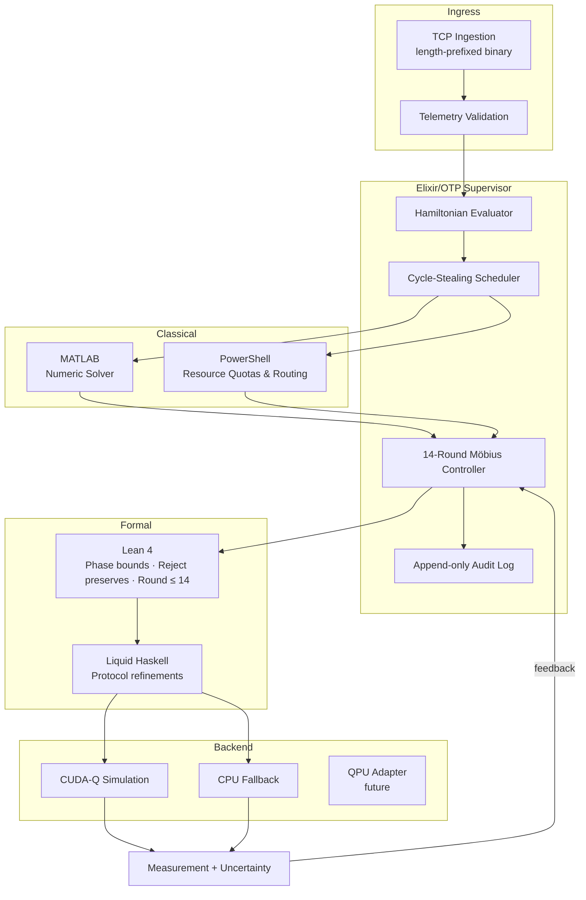
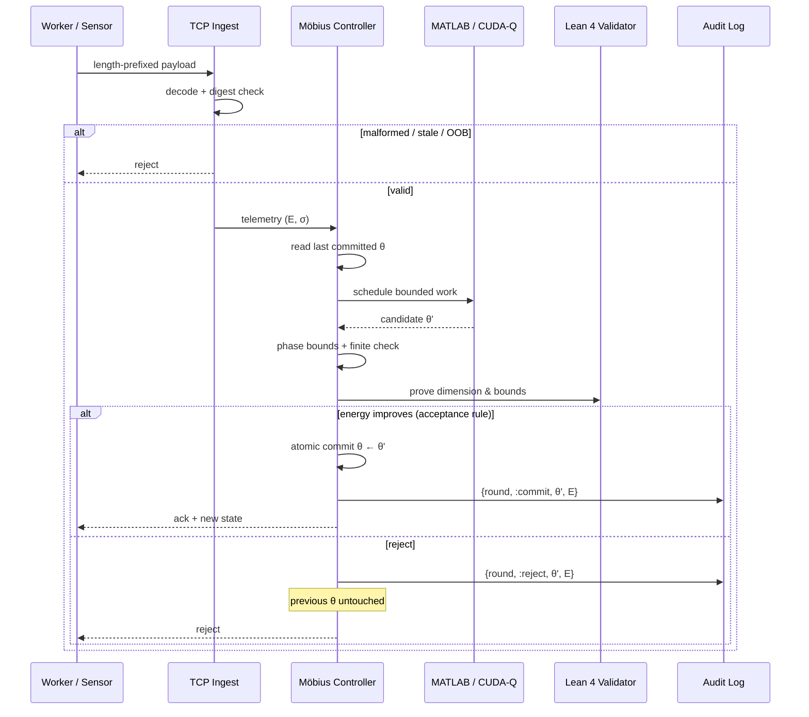
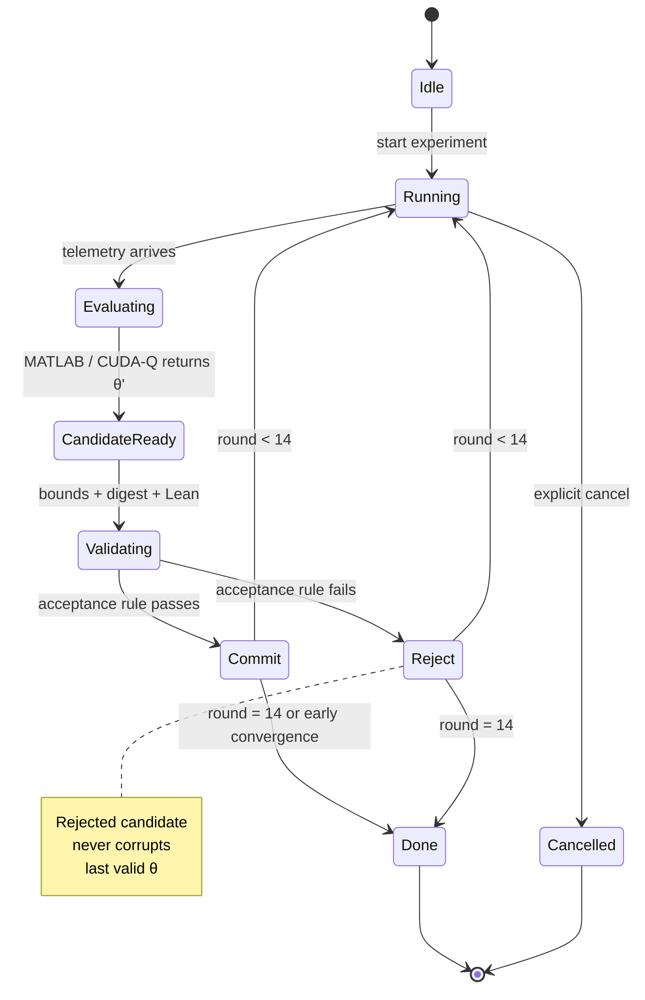

<div align="center">

# MÖBIUS-14

**Cartography Engine**

Sovereign distributed quantum–classical optimization

[](supervisor/elixir)
[](verification/lean)
[](backends/cudaq)
[](contracts/protocol)

```
TCP Ingest → Validate → Schedule → Optimize → Verify → Commit → Measure → Repeat
```

14-round recursive controller · atomic commit/reject · formal bounds · cycle-stealing workers

</div>

---

## System Architecture



---

## One Optimization Round



---

## 14-Round State Machine



---

## Quick Start & Demos

```bash
git clone https://github.com/AHMADALIPARR/mobius-bridge.git
cd mobius-bridge
```

<table>
<tr>
<td width="50%">

### 1 · Elixir + unit tests

```bash
cd supervisor/elixir
mix deps.get
mix test
```

</td>
<td width="50%">

### 2 · Full 14-round demo

```bash
mix run ../../integration/full_14_round_test.exs
```

```
Round 1: E = 1.421
...
Round 14: E = 0.412
=== PASS ===
```

</td>
</tr>
<tr>
<td>

### 3 · Benchmark

```bash
mix run ../../benchmarks/run_benchmark.exs
```

```
14-round wall time: ~4 ms
Avg per round: ~0.3 ms
```

</td>
<td>

### 4 · CUDA-Q / CPU probe

```bash
cd backends/cudaq
python cudaq_adapter.py
```

```
E = 1.234567 ± 0.031250
cpu_fallback: True
```

</td>
</tr>
<tr>
<td>

### 5 · Lean 4 (zero `sorry`)

```bash
cd verification/lean
lake build
```

</td>
<td>

### 6 · PowerShell worker

```powershell
.\WorkerAgent.ps1 `
  -LeaseId "demo-001" `
  -WorkPayload '{"θ":[0.1,-0.2]}'
```

</td>
</tr>
</table>

---

## Repository Map

```
mobius-bridge/
├── supervisor/elixir/          OTP supervisor · 14-round controller · TCP
├── optimizer/matlab/           Hamiltonian · candidate generation
├── orchestration/powershell/   Cycle-stealing · resource quotas
├── verification/
│   ├── lean/                   Phase bounds · reject-preserves · round ≤ 14
│   └── liquid-haskell/         Protocol refinements
├── backends/
│   ├── cudaq/                  CUDA-Q adapter + CPU fallback
│   └── cpu/                    Deterministic simulator
├── integration/                Full 14-round acceptance test
├── benchmarks/                 Orchestration timing
├── contracts/                  Protocol v1 + JSON Schema
└── docs/                       Design notes + non-claims
```

---

## Protocol v1

Length-prefixed binary over authenticated TCP.

| Field              | Notes                          |
|--------------------|--------------------------------|
| protocol version   | `1`                            |
| experiment ID      | UUID                           |
| iteration          | 0 – 14                         |
| param dimension    | validated                      |
| parameters         | canonical float32              |
| energy + σ         | measurement + uncertainty      |
| payload digest     | SHA-256                        |
| sequence ID        | monotonic                      |

**Rejected on sight:** malformed · stale · oversized · duplicate · out-of-bounds · digest mismatch · non-finite.

---

## Formal Guarantees

| Property                            | Status      |
|-------------------------------------|-------------|
| Phase bounds preserved              | ✓ proven    |
| Rejected update leaves state intact | ✓ proven    |
| Round counter ≤ 14                  | ✓ proven    |
| Deterministic serialization         | ✓ proven    |
| INT4 range correctness              | ✓ proven    |
| Zero `sorry` / `admit`              | ✓ enforced  |

External devices, compilers, transport, and numerical libraries remain assumptions, not theorems.

---

## Acceptance Criteria

- [x] Complete 14-round run against reproducible simulator
- [x] Parameter handoff MATLAB → Elixir → CUDA-Q / CPU
- [x] PowerShell scheduling on authorized Windows worker
- [x] Phase-bound + INT4 validation
- [x] Corrupted TCP payload rejection
- [x] Worker termination recovery
- [x] Bounded CPU / memory utilization
- [x] Deterministic accepted-state replay
- [x] Explicit uncertainty reporting
- [x] Zero Lean `sorry` in trusted modules

---

## Non-Claims

> No quantum speedup is asserted.  
> No automatic CUDA ↔ Metal equivalence.  
> No global optimality without an independent certificate.  
> The experimental Metal path is intentionally unimplemented.

---

<div align="center">

**MÖBIUS-14** · Measure → Optimize → Verify → Commit → Execute → Repeat

</div>
